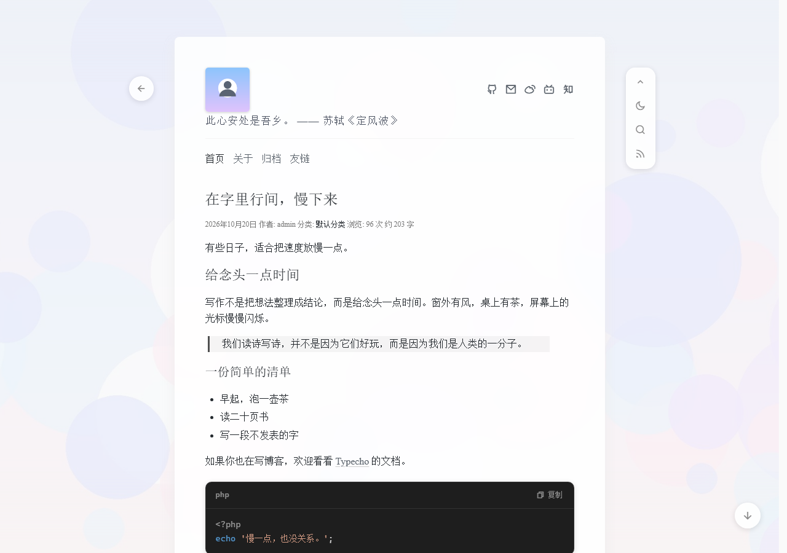
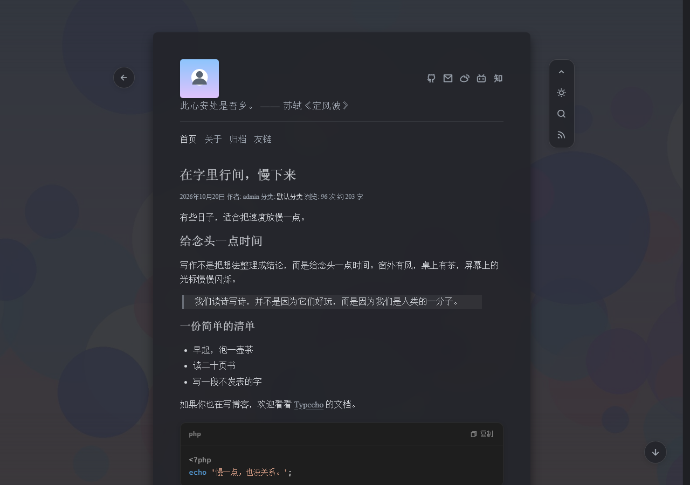

# YingK

> 一个安静、克制的 Typecho 单栏博客主题。让页头保持不动，让文字成为主角。

[](https://typecho.org/)
[](https://www.php.net/)
[](LICENSE)
[](https://github.com/yiktt/YingK)

YingK 基于 [heysiu/Ying](https://github.com/heysiu/Ying) 二次开发，重做了移动端布局、局部加载、主题设置与阅读细节。项目不依赖 jQuery、不加载 CDN，图标与代码高亮全部本地托管。

## 预览

截图使用 Typecho 1.3.0 + PHP 8.3 实际渲染，内容为演示文章。

| 白天 | 夜间 |
| --- | --- |
|  |  |

## 特性

- **阅读优先**：600px 单栏、宋体 + Times New Roman、安静的留白与玻璃卡片。
- **夜间模式**：跟随系统偏好、localStorage 记忆、右上工具坞一键切换，首屏无闪白。
- **AJAX 局部加载**：站内跳转只替换内容区，页头保持不动；支持前进/后退、滚动位置恢复与标题焦点管理。
- **一言**：固定内容或一言 API；API 模式可多选分类、可选出处，3 秒超时后自动回退固定内容。
- **动态友链与联系方式**：后台可视化增删，不再手写 JSON；兼容旧版固定字段。
- **文章页**：中文日期、浏览计数、字数统计、标签、代码块语言标签与一键复制、回到顶部/直达底部、返回列表。
- **后台可调**：内置头像、全站背景图、卡片透明度、页脚版权、ICP/公安备案号。
- **页面**：归档、友链、关于、普通页面与 404 页；归档链接适配 Typecho 自定义固定链接。
- **安全与隐私**：输出转义、友链/联系方式协议白名单、浏览量不存储 IP、外链 `rel="noopener"`。
- **无评论**：继承上游“无评论”的定位，专注阅读；需要评论时可自行接入评论组件。

## 环境要求

| 项目 | 要求 |
| --- | --- |
| Typecho | 1.2.1 及以上，1.3.0 实测 |
| PHP | 8.x |
| 数据库 | Typecho 支持的 MySQL / MariaDB / SQLite / PostgreSQL |
| 浏览器 | Chrome、Edge、Firefox、Safari 等现代浏览器，不支持 IE |
| 可选网络 | 一言 API 模式需要访问 `v1.hitokoto.cn` |

## 安装

1. 将主题目录放入 Typecho 的 `usr/themes/`，例如：

   ```bash
   cd usr/themes
   git clone https://github.com/yiktt/YingK.git YingK
   ```

2. 后台「控制台 → 外观」启用 **YingK**。
3. 进入「控制台 → 外观 → 设置外观」，配置头像、一言、背景图、联系方式、友链等。

> 主题设置按目录名保存。如果启用后修改主题文件夹名称，需要重新配置外观设置。

## 独立页面

在「管理 → 独立页面 → 新增页面」创建页面，并在右侧「自定义模板」中选择对应模板：

| 页面 | 模板文件 | 说明 |
| --- | --- | --- |
| 归档 | `articles.php` | 按年月分组列出全部已发布文章，自动排除定时发布文章 |
| 友链 | `links.php` | 读取外观设置中的友链数据；页面正文不渲染 |
| 关于 | `about.php` | 顶部“站长 / 主题 / 程序”名片 + 页面正文 |
| 普通页面 | 默认模板 | 仅显示标题与正文 |

- 旧版本的 `start-page` slug 页面仍会被识别为关于页，显示同样的名片；新站点建议直接使用 `about.php` 模板。
- 友链页可在外观设置中整体隐藏；隐藏后导航不再显示友链入口。
- 归档页与友链页的页面正文不会被输出，适合只作为功能页使用。

## 设置项

| 设置 | 说明 |
| --- | --- |
| 头像 | 头像 URL；留空使用主题内置 `avatar.png` |
| 一言来源 | 固定内容 / 一言 API |
| 一言（固定内容） | 纯文本；仅在固定内容模式显示 |
| 一言分类 | API 模式可多选：文学、诗词、哲学、动画、漫画、游戏、影视、网易云 |
| 一言出处 | API 模式是否追加“—— 作者《出处》” |
| 背景图 | 全站背景 URL；留空使用内置背景；带查询参数的 URL 也支持 |
| 卡片透明度 | 0–100 的百分比，越小越透出背景图；默认 75 |
| 联系方式 | 预设 GitHub / 邮箱 / 微博 / X / B站 / 知乎 / Telegram / 自定义链接；自动补全协议 |
| 页脚版权 | 显示在页脚左侧；`{Y}` 会替换为当前年份 |
| 备案号（ICP） | 留空不显示，自动链接到工信部备案查询 |
| 公安备案号 | 显示在 ICP 下方，自动链接到公安备案查询 |
| 友链页 | 显示 / 隐藏友链入口 |
| 友链管理 | 头像、名字、链接、简介；头像留空用首字徽标 |

联系方式和友链以 JSON 保存，但不需要手动编辑：后台提供增删与实时预览，保存时会校验 JSON 格式。旧版本固定字段会在首次打开设置或首次渲染时自动兼容读取。

## 一言 API

- 分类参数会以多个 `c` 参数发送给 [hitokoto](https://developer.hitokoto.cn/)。
- 请求 3 秒超时；失败、超时或无内容时回退到固定内容，不会留下空白。
- 只有启用 API 模式时浏览器才会访问第三方接口；固定内容模式没有任何外部请求。
- 移动端（宽度 ≤ 767px）会隐藏一言以控制页头高度，桌面端完整显示。

## 浏览量说明

- 计数保存在文章的 `views` 自定义字段，后台文章编辑页可以看到该字段。
- 同一浏览器对同一篇文章 **24 小时内只计一次**，使用 `ying_view_<cid>` Cookie 去重；不记录 IP，也不会在 `typecho_fields` 中写入每日去重标记。
- 清除 Cookie、换浏览器或使用无痕窗口会重新计数；爬虫与刷量不会被过滤，因此它表示“浏览热度”，不是独立访客数。
- 从 3.1 升级后，首次打开「设置外观」会清理旧版 `view_<md5>` 标记，不再污染后台自定义字段列表。

## AJAX 与渐进增强

主题会拦截同源站内链接，通过 `fetch` 替换内容区，页头、主题切换、搜索工具坞保持不变。以下情况会自动回退为整页跳转：

- 响应不是 2xx（包括 404）；
- 目标页面内容区包含 `<script>`（避免脚本不执行）；
- 页面结构不符合主题约定；
- 链接带 `download`、`target` 非 `_self`、跨域或指向后台；
- 链接显式添加了 `data-no-ajax`。

```html
<a href="/archives/42/" data-no-ajax>整页打开这篇</a>
```

换页后会恢复上一页的滚动位置、把焦点移到新页面 `h1`，并显示顶部细进度条。搜索表单、后台表单与站外链接不参与局部加载。

## 兼容性与性能

- **固定链接**：默认 `/archives/{cid}/`、`/archives/{slug}.html`、日期归档、分类归档均已实测；归档页使用 Typecho 内容组件生成链接，不依赖手动拼接。
- **资源**：无构建步骤、无运行时框架。首屏约 0.5MB（未压缩，含图标字体与背景图）；文章含代码时再按需加载约 127KB 的 highlight.js。
- **字体**：正文使用系统宋体 / Times New Roman；RemixIcon 仅保留 woff2，减少安装包体积。
- **可访问性**：支持键盘焦点、`aria-current`、`aria-pressed`、`aria-expanded`、减少动态效果偏好；主要触控目标提升到 44px；已移除禁止缩放的 viewport 设置。
- **响应式**：390 / 752 / 1000 / 1200 宽度与浅色/暗色均已回归验证。

## 常见问题

**为什么没有评论？**
上游 Ying 的定位就是无评论阅读主题，YingK 保留这一取舍，不包含 `comments.php`。

**一句话不显示？**
检查是否选择了 API 模式、服务器能否访问 `v1.hitokoto.cn`；接口失败时会回退到固定内容。移动端不显示一言是刻意设计。

**友链 / 归档 / 关于页怎么建？**
新建独立页面，分别选择 `links.php` / `articles.php` / `about.php` 模板；友链数据在外观设置里维护。

**浏览量为什么比统计工具少？**
浏览量按浏览器 Cookie 24 小时去重，且不过滤爬虫；清 Cookie 会重新计数。它用于展示文章热度，不等同于独立访客统计。

**切换页面后某些脚本没执行？**
主题检测到内容区含脚本会自动整页加载。插件脚本或特殊链接可加 `data-no-ajax` 强制整页打开。

**可以关闭 AJAX 吗？**
当前没有全局开关；给站内链接加 `data-no-ajax` 即可按链接关闭局部加载。

## 更新记录

### 3.2（2026-10）

- 修复移动端返回按钮遮挡头像、右上工具坞覆盖联系方式的问题；联系方式在窄屏换行显示。
- 修复正文链接不可识别、无序列表丢失项目符号与缩进；恢复正文列表层级。
- 归档页改用 Typecho 内容组件：修复自定义固定链接下的坏链接，排除定时发布文章，月份链接补零，归档内容查询不再按月份逐次执行。
- 浏览量改为 Cookie 24 小时去重，不再写入 `view_<md5>` 标记，不存储 IP；升级后自动清理旧标记。
- AJAX 增加滚动恢复、`h1` 焦点、进度条、`aria-busy`、含脚本页面自动回退、`data-no-ajax`。
- 404 页修复“回到上一页”无历史时的错误回退，移除自动聚焦，搜索框改为 16px 防 iOS 缩放。
- 新增 `about.php` 关于模板，旧 `start-page` slug 继续兼容。
- 提升小字对比度、触控尺寸、键盘 ARIA 与减少动态效果支持；允许页面缩放。
- 修正背景图 URL 的 CSS 转义、默认一言错字、标签列表标记、normalize 加载顺序；默认头像使用内置图片。
- RemixIcon 仅保留 woff2，移除冗余字体；重写 README 与主题截图。

### 3.1 及更早

- Typecho 1.2+/1.3 命名空间适配、夜间模式、AJAX、动态友链与联系方式、代码高亮、归档/友链/404 页面。

## 开发与验证

- 无构建步骤：直接修改 PHP、`css/main.css`、`js/app.js` 即可。
- 本次发布在 **Typecho 1.3.0 + PHP 8.3.36 + SQLite** 上完成：PHP 语法检查、设置页保存/JSON 校验、旧标记清理、Cookie 去重、默认 cid / slug / 日期 / 分类固定链接、定时文章过滤、AJAX 前进后退与脚本回退、404、搜索与多宽度渲染均有实测。
- Typecho 1.2.1 的命名空间 API 与 1.3.0 源码对照通过；1.2.1 未做运行时回归。

## 许可

本仓库中 YingK 的修改与新增代码以 **MIT** 协议发布，详见 [LICENSE](LICENSE)。

原主题 **Ying（颖）** 由颖宝创作（[heysiu/Ying](https://github.com/heysiu/Ying)），原仓库未声明许可证。本项目保留原作者署名，原始主题的设计与素材权利归原作者所有；如需将原主题部分用于闭源或商业再分发，请先取得原作者明确授权。

## 致谢

- 原主题：[heysiu/Ying](https://github.com/heysiu/Ying) by 颖宝
- 图标：[Remix Icon](https://remixicon.com/)（Remix Icon License 1.0）
- 代码高亮：[highlight.js](https://highlightjs.org/) v11.11.1（BSD-3-Clause）
- 博客程序：[Typecho](https://typecho.org/)
