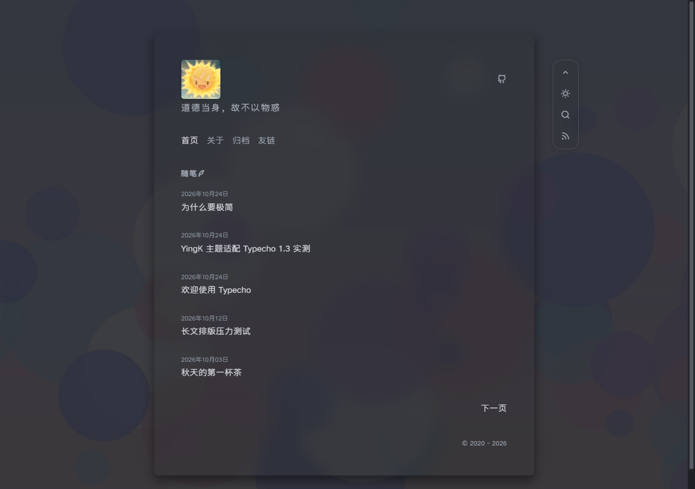

# YingK

> 一个安静、克制的 [Typecho](https://typecho.org/) 单栏博客主题。

**状态**：活跃维护；最近验证 2026-10-29；不单独维护版本号，变更以 [Git 提交记录](https://github.com/yiktt/YingK/commits/main) 为准。

**许可**：YingK 的新增/修改代码为 MIT；上游 Ying 未声明许可证，原主题素材与默认字体需另行确认授权。详见[许可](#许可)。

[](https://typecho.org/)
[](https://www.php.net/)
[](LICENSE)

<p align="center">
  
</p>

## 预览

截图使用 Typecho 1.3.0 + PHP 8.3 实际渲染，内容为演示文章。

> 根目录 `screenshot.png` 同时作为 Typecho 后台主题缩略图；其余截图位于 `docs/`。

### 首页

| 白天 | 夜间 |
| --- | --- |
|  |  |

## 为什么是 YingK

YingK 把博客当成一张纸：600px 单栏、无评论、无侧栏、无构建步骤、无 jQuery。图标、代码高亮与背景本地托管；默认字体 ZQL 随仓库托管、经 jsDelivr 加载，也可切换本地、系统或自定义字体。

和 Typecho 默认主题或功能型主题相比，YingK 的取舍是：不做评论、侧栏和页面构建器，把预算放在单栏排版、移动端、局部加载、密码文章和字体上。与上游 [Ying](https://github.com/heysiu/Ying) 相比，它保留单栏无评论的定位，重做了移动端与局部加载，并补齐后台设置、字体、关于页、友链与密码文章等细节。

如果你需要评论、侧栏、页面构建器、复杂插件生态或多语言界面，Typecho 默认主题或功能更全的主题会更合适。

## 快速开始

> 前置：先完成 Typecho 安装（[下载](https://typecho.org/download) / [文档](https://docs.typecho.org/)）；本主题不包含 Typecho 本体，数据库与 PHP 扩展按 Typecho 要求配置。

| 要求 | 说明 |
| --- | --- |
| Typecho | 1.2.1 及以上；1.3.0 运行时实测，1.2.1 仅做 API 源码对照 |
| PHP | 8.x；8.3.36 实测 |
| 数据库 | Typecho 支持的 MySQL / MariaDB / SQLite / PostgreSQL |
| 浏览器 | Chrome、Edge、Firefox、Safari 等现代浏览器，不支持 IE |
| 可选网络 | 一言 API（`v1.hitokoto.cn`）；默认字体经 jsDelivr CDN 加载，自定义字体地址取决于服务商 |

```bash
cd usr/themes
git clone https://github.com/yiktt/YingK.git YingK
```

没有 shell 环境时，也可以下载 [ZIP](https://github.com/yiktt/YingK/archive/refs/heads/main.zip) 并解压到 `usr/themes/YingK`。

1. 后台「控制台 → 外观」启用 **YingK**。
2. 进入「控制台 → 外观 → 设置外观」，配置字体、头像、标签页图标、一言、背景图、关于页结构化内容与自定义内容板块、联系方式、友链等。

> 首次启用默认：头像输入框留空（前台使用主题内置头像）、标签页图标留空（跟随头像）、一言为固定内容且只显示句子、新文章标记默认关闭、一条指向[本项目](https://github.com/yiktt/YingK)的 GitHub 联系方式、一条 Typecho 官方友链。联系方式选择“自定义链接”时可以填写图标 URL。

3. 新建独立页面，并在「自定义模板」中选择对应模板：

| 页面 | 模板文件 |
| --- | --- |
| 归档 | `articles.php` |
| 友链 | `links.php` |
| 关于 | `about.php` |
| 普通页面 | 默认模板 |

> 启用后访问站点首页，应能看到头像、导航和「随笔」文章列表；归档、友链、关于页再按上表创建。

> 关于页使用「站点档案 · 摘录笺」版式（单栏页边摘录、统计卡、站点足迹、文章活跃热力图）；内容板块可在后台继续新增，正文完全由「设置外观」维护，独立页面编辑器正文可留空、不参与渲染。主题设置按目录名保存；如果启用后修改主题文件夹名称，需要重新配置外观设置。

> [!WARNING]
> 使用 SQLite 时，`usr/typecho.db` 位于 Web 根目录，必须禁止外部访问。Nginx / Apache 的具体配置与上传目录例外见[部署安全提示](docs/configuration.md#部署安全提示)。

更完整的字段、页面模板和运行细节见 **[配置说明](docs/configuration.md)**。

## 功能

- **阅读优先**：600px 单栏、后台字体来源（ZQL CDN / 本地字体 / 系统字体 / 鸿蒙 CDN / 自定义地址）、玻璃卡片与留白。
- **置顶文章**：外观设置「置顶」分组手动填写文章 ID / 别名，最多 3 篇；首页第一页用连续朱砂竖线串联，第一篇日期旁显示「置顶」小印，并从下方普通列表移除；加密文章自动跳过。
- **夜间模式**：跟随系统偏好、localStorage 记忆、右上工具坞切换（移动端为页头联系方式旁的汉堡菜单），首屏无闪白；头像在首次加载完成后淡入上浮，减少动态效果偏好下直接显示。
- **AJAX 局部加载**：站内链接与搜索提交都只替换正文；前进/后退恢复滚动，焦点回到新页面标题，异常自动回退整页。
- **一言**：固定内容或 API；分类与出处可选；可选显示在头像下方或联系方式图标下方；3 秒超时回退。
- **友链与联系方式**：后台可视化增删，兼容旧字段；联系方式支持自定义链接图标；友链页可整体隐藏。
- **文章页**：中文日期、浏览计数、字数、标签、代码高亮与复制、回到顶部/底部。
- **密码文章**：锁定态为「编年 · 已加锁」小眉 + 「密」印 + 下划线输入 + 文字钮，与 404 同一套设计语言；解锁前不输出标题、日期、作者、分类、浏览等元信息，也不再输出标签/摘要的 meta；口令错误在同页内联提示（朱砂小字 + 密印轻震）而不跳转；关于、归档、友链等自定义模板被设密码时只显示核心解锁表单，解锁后恢复正常内容。可选接管核心 403/5xx 错误页（编年 + 封印版式，主题提供 `error.php`，在 `config.inc.php` 加一行启用）。
- **关于页**：「站点档案 · 摘录笺」版式，单栏页边摘录、统计卡、自动站点足迹与近一年文章活跃热力图；导语/关于主题/结尾寄语/自定义板块正文支持 Markdown，内容方向/技术栈保持结构化行编辑，三个小标题可后台改名，并可在后台新增「标题 + 正文」板块。时间线和热力图只使用已发布文章的时间/标题数据，锁定文章只显示占位标题，可在后台分别关闭。
- **后台可调**：七组侧签式外观设置；置顶文章、站点足迹、文章活跃热力图、关于页六个结构化内容字段与自定义内容板块；内置头像、标签页图标（favicon）、背景图、新文章标记（小印 / 相对时间）、建站日期与关于页统计（篇数 / 字数 / 运行时长逐项勾选、标题下或文末落款、左 / 中 / 右对齐）、字体库上传/选择/删除、卡片透明度、页脚版权、ICP / 公安备案号。
- **页面**：归档、友链、关于、404；归档链接适配 Typecho 自定义固定链接。
- **安全与隐私**：输出转义、协议白名单、浏览量不存储 IP、外链 `rel="noopener"`。默认字体经 jsDelivr CDN 加载；可切换站点本地字体或系统字体，只有所选来源才会请求外部服务。自定义联系图标只接受 http(s) 或站内路径，并会从该地址加载图片。联系方式与友链 JSON 的根节点必须是列表并校验字段类型；字体上传除签名外还校验容器长度与表目录边界。

## 兼容性与性能

- **固定链接**：默认 `/archives/{cid}/`、`/archives/{slug}.html`、日期归档、分类归档均已实测；归档页只查询标题、时间与链接所需字段，不装载正文，链接仍由 Typecho 路由生成。置顶文章链接同样走 Typecho 路由，已适配分类 / 日期等自定义固定链接。
- **统计缓存**：关于页的文章数/总字数/运行天数使用轻量签名缓存；文章发布、删除、编辑或建站日期变化后自动失效，另有 24 小时兜底刷新，小站输出不变。
- **关于页数据**：站点足迹与热力图只读取已发布文章的时间/标题字段，不使用 `pageSize=9999`、不产生 N+1；共享轻量签名缓存，文章/时区/建站日期变化以及文章加锁/解锁后失效。数据缓存放在 PHP 临时目录，不写入 Web 根；不可写时回退实时计算。
- **资源**：无构建步骤、无运行时框架。主题目录约 7.8MB（含字体约 6.7MB）；默认经 jsDelivr 加载 ZQL 子集，按字频分三片并按 `unicode-range` 按需下载：常见页面首访约 0.7MB，正文页通常约 0.9MB（整包 1.26MB）；本地字体模式只加载选中文件，未选择时系统字体（0 下载）；鸿蒙 CDN 约 5.4MB。文章含代码时额外按需加载约 127KB 的 highlight.js。
- **字体**：默认 ZQL CDN（仓库托管、jsDelivr 加载，Fastly 兜底）；鸿蒙 CDN 同样仓库托管；可切换站点本地字体、系统字体、鸿蒙 CDN 或自定义地址（外部地址需支持 CORS）。后台支持 woff2 / woff / ttf / otf 上传、选择与删除；RemixIcon 按主题实际用到的 20 个图标子集化（woff2 + CSS 共约 4.1KB）。
- **无 JS**：页面与正文链接可读，“返回列表”链接可用；主题切换、搜索面板、代码高亮/复制与 AJAX 局部加载不可用。
- **可访问性**：支持键盘焦点、`aria-current`、`aria-pressed`、`aria-expanded`、减少动态效果偏好、跳转主内容链接；工具坞收起时隐藏控件退出 Tab 顺序，跨断点自动清理移动端定位；主要触控目标 44px；已移除禁止缩放的 viewport 设置。正文图片默认 `loading="lazy"`。
- **响应式**：390 / 752 / 1000 / 1200 宽度与浅色/暗色均已回归验证。

## 常见问题

**为什么没有评论？**
上游 Ying 的定位就是无评论阅读主题，YingK 保留这一取舍，不包含 `comments.php`。

**字体文件有多大？**
默认字体是 ZQL 子集（约 1.2MB woff2），随主题仓库托管、经 jsDelivr CDN 加载，`font-display: swap` 让文字先显示。也可在后台切换：站点本地字体（后台上传，大小取决于文件）、系统字体（0 下载）、鸿蒙 CDN（约 5.4MB，随仓库托管）、自定义地址。

**友链 / 归档 / 关于页怎么建？**
按[快速开始](#快速开始)中的模板表创建独立页面；友链与关于页内容都在外观设置里维护，页面正文可留空，详见[配置说明](docs/configuration.md)。

**浏览量为什么比统计工具少？**
浏览量按浏览器 Cookie 24 小时去重，且不过滤爬虫；清 Cookie 会重新计数。它用于展示文章热度，不等同于独立访客统计，详见[配置说明](docs/configuration.md#浏览量)。

**切换页面后某些脚本没执行？**
主题检测到内容区含脚本会自动整页加载。插件脚本或特殊链接可加 `data-no-ajax` 强制整页打开，详见[配置说明](docs/configuration.md#ajax-与渐进增强)。

## 开发与验证

- 无构建步骤：直接修改 PHP、`css/main.css`、`js/app.js`；后台样式与交互分别在 `css/admin.css`、`js/admin.js`。
- 升级：保持主题目录名不变，拉取或覆盖主题文件即可；外观设置与文章数据保存在 Typecho 数据库中。
- 卸载/迁移：切换回其他主题即可；外观设置保存在 Typecho 数据库，迁移时随数据库一起备份。
- 本项目不单独维护发布编号；变更以 Git 提交记录为准。
- 本次验证在 **Typecho 1.3.0 + PHP 8.3.36 + SQLite** 上完成：PHP 语法检查、设置页保存/JSON 校验、锁定模板与元信息、默认联系方式与友链、自定义联系图标与不安全地址回退、字体来源切换、字体结构校验、字体库选择/上传/同名替换/删除、非法文件与字体地址校验、透明度单位、旧标记清理、Cookie 去重、默认 cid / slug / 日期 / 分类固定链接、定时文章过滤、AJAX 前进后退与脚本回退、跨页锚点、跨断点工具坞与搜索焦点、关于页站点档案/摘录笺、自定义内容板块、统计卡数量/位置/对齐、时间线与热力图开关、无数据与锁定标题、置顶文章 ID/别名解析/去重/首页置顶与跨分页去重均在本地隔离副本完成；关于页另在 390 / 752 / 1000 / 1200 宽度与浅色/暗色完成真实浏览器截图和回归。
- Typecho 1.2.1 的命名空间 API 与 1.3.0 源码对照通过；1.2.1 未做运行时回归。
- 维护者：[@yiktt](https://github.com/yiktt)；问题与建议：[GitHub Issues](https://github.com/yiktt/YingK/issues)。

## 许可

本仓库中 YingK 的修改与新增代码以 **MIT** 协议发布，详见 [LICENSE](LICENSE)。

默认字体 ZQL（走路带风小可爱简 Regular 子集）位于 `assets/fonts/zql-c1.woff2` / `zql-c2.woff2` / `zql-c3.woff2`（按字频分片），随本仓库分发并经 jsDelivr CDN 提供；字体站标注其商用须授权，复用前请自行确认。可选字体 HarmonyOS Sans SC Medium 位于 `assets/fonts/harmonyos-sans-sc-medium.woff`，同样随仓库分发，受 HarmonyOS Fonts License Agreement 约束。后台上传的字体由站点管理员自行提供，保存在 `usr/uploads/fonts`，不属于本仓库；上传前请确认字体授权允许你的站点使用。

原主题 **Ying** 的归属以上游仓库为准：[heysiu/Ying](https://github.com/heysiu/Ying)。该仓库所有者为 [heysiu](https://github.com/heysiu)（GitHub 资料名 Siu）。原仓库未声明许可证。本项目保留上游仓库信息，原始主题的设计与素材版权归其原作者及贡献者所有；如需将原主题部分用于闭源或商业再分发，请先取得上游作者的明确授权。

## 致谢

- 原主题：[heysiu/Ying](https://github.com/heysiu/Ying)
- 默认字体：ZQL「走路带风小可爱简」Regular 子集（`assets/fonts/zql-c1/c2/c3.woff2` 按字频分片，经 jsDelivr CDN 提供）
- 字体：HarmonyOS Sans SC Medium（`assets/fonts/harmonyos-sans-sc-medium.woff`，经 jsDelivr CDN 提供；Copyright Huawei Device Co., Ltd.，HarmonyOS Fonts License Agreement）
- 图标：[Remix Icon](https://remixicon.com/)（Remix Icon License 1.0）
- 代码高亮：[highlight.js](https://highlightjs.org/) v11.11.1（BSD-3-Clause）
- 博客程序：[Typecho](https://typecho.org/)
